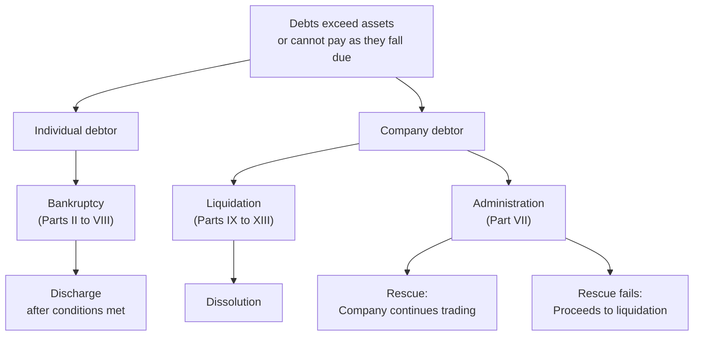
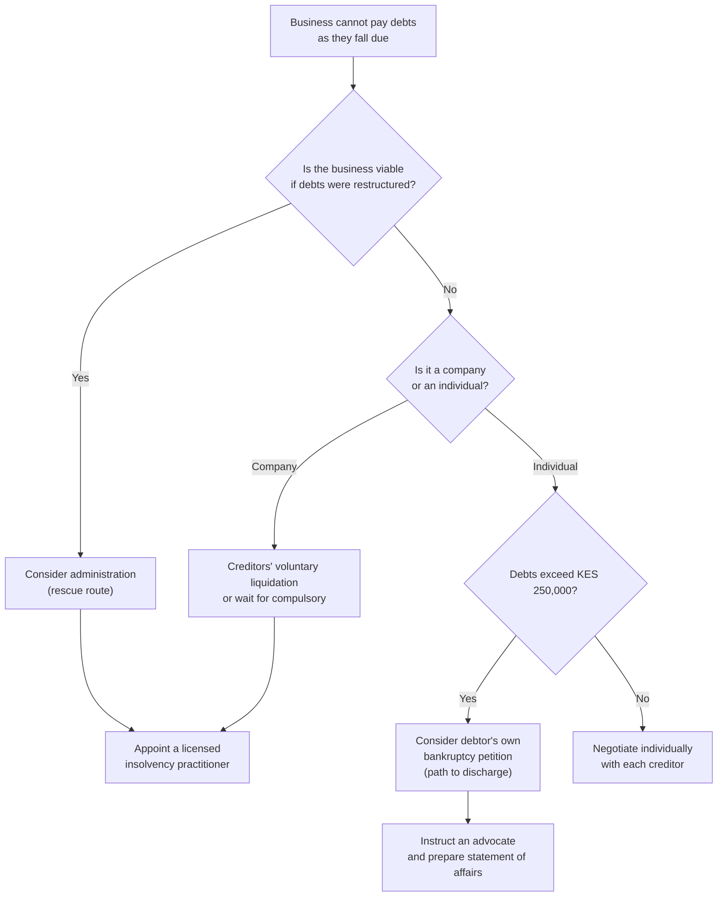

Every article in the enforcement cluster so far has dealt with a specific creditor pursuing a specific debt: a decree, an attachment, a garnishee order, a limitation period. This article stands back from the individual claim and asks the question that comes when the claims, taken together, exceed the assets.

That question has a statutory answer. The **Insolvency Act, 2015** (No. 18 of 2015), which repealed the old Bankruptcy Act and the winding-up provisions of the Companies Act, provides a unified framework for both individual insolvency (bankruptcy) and company insolvency (liquidation and administration). It also introduced a mechanism that Kenyan business owners rarely consider until it is too late: **administration**, a court-supervised rescue procedure that tries to keep a viable business alive while restructuring its debts.

This guide is not written for creditors. It is written for the debtor, whether an individual or a business owner, who is trying to understand what the framework does, what choices exist, and what the consequences actually are.

> **Key Insight:** Insolvency law does two things that seem contradictory and are both important. It provides a **collective** process that prevents a race by individual creditors to grab what they can, which protects both the debtor and the creditors who would have been too slow. And it provides a **discharge** mechanism that, after certain conditions are met, releases the individual debtor from unpaid debts and allows a fresh start. No other process in Kenyan law does that second thing. A decree, a write-off, and a limitation bar all leave the debt alive in some form. Only a bankruptcy discharge extinguishes it.

### Part 1: The Insolvency Act 2015 at a Glance

The Act draws a firm line between the individual and the company, because the consequences differ. An individual debtor faces personal restrictions during bankruptcy but earns a statutory discharge. A company in liquidation is wound up and dissolved, ceasing to exist. A company in administration gets a breathing space while an administrator tries to achieve one of three statutory purposes: rescuing the company as a going concern, achieving a better result for creditors than an immediate liquidation, or realising property to make a distribution.

### Part 2: Individual Insolvency (Bankruptcy)

#### Who Can Be Made Bankrupt

Any individual debtor who is **unable to pay their debts** may be the subject of a bankruptcy application. The Act defines inability to pay debts in two ways:

1. **The cash-flow test:** the debtor is unable to pay debts as they fall due in the ordinary course.
2. **The balance-sheet test:** the value of the debtor's liabilities exceeds the value of their assets, taking into account contingent and prospective liabilities.

Either test is sufficient.

#### The Creditor's Petition

A creditor may present a bankruptcy petition where the debt owed to the petitioning creditor (or creditors acting jointly) is at least **KES 500,000**. The debt must be a liquidated sum (a fixed, ascertained amount) that is payable immediately or at a certain future time.

Before presenting the petition, the creditor will usually have served a **statutory demand** giving the debtor **21 days** to pay, and the debtor will have failed to pay or to set aside the demand. The failure to comply with a statutory demand is evidence that the debtor is unable to pay their debts.

A debtor who disputes the underlying debt should apply to **set aside the statutory demand** within the 21-day period, not ignore it. Ignoring it creates a presumption that is difficult to reverse once a petition is presented.

#### The Debtor's Own Petition

An individual whose debts exceed their assets may also file their own bankruptcy petition. The threshold for a debtor's own petition is **KES 250,000**. This is the less common route, but it serves a genuine purpose: it stops the collection pressure, imposes order on the claims, and opens the path to discharge.

A debtor's petition must be accompanied by a statement of affairs listing all assets, all liabilities, all creditors, and details of the debtor's income and expenditure. Inaccuracy or dishonesty in this statement is a criminal offence.

#### What Happens During Bankruptcy

Once a bankruptcy order is made:

1. **A trustee in bankruptcy is appointed.** The trustee's role is to take control of the bankrupt's property, realise it, investigate the affairs, and distribute the proceeds to creditors according to the statutory priority.
2. **The bankrupt's property vests in the trustee.** With limited exceptions, the bankrupt loses the right to deal with their own assets.
3. **An automatic stay** takes effect: individual creditors can no longer pursue separate actions against the bankrupt without the court's leave. This is the collective mechanism that replaces the race.
4. **The bankrupt faces statutory restrictions.** These include a prohibition on obtaining credit of more than a specified amount without disclosing the bankruptcy, restrictions on acting as a company director, and restrictions on carrying on business in a name other than that in which the bankruptcy was adjudicated.

**Protected property** in bankruptcy mirrors but does not perfectly track the Civil Procedure Act exemptions discussed in [what a creditor cannot take](/blog/protected-property-attachment-kenya). The two-thirds salary protection, the tools-of-trade exemption, and the pension protections all remain relevant, and the trustee must respect them.

#### Discharge

This is the part of bankruptcy law that matters most to the debtor and is least understood.

A **bankrupt is automatically discharged** from bankruptcy three years after the date of the bankruptcy order, unless the Official Receiver or a creditor successfully applies for an extension. Discharge may be postponed where the bankrupt has not cooperated with the trustee, has concealed property, has been dishonest in the statement of affairs, or has previously been bankrupt.

The effect of discharge is profound. It **releases the bankrupt from all bankruptcy debts** except:

- Debts incurred by fraud
- Court-ordered maintenance or other family obligations
- Student loan debts where specifically excluded
- Debts arising from personal injury claims caused by negligence

Discharge does not return the property to the bankrupt. The trustee continues to administer the estate. But the bankrupt is free of the obligations and free of the restrictions.

$$ \text{Timeline: Petition} \xrightarrow{\text{21 days (statutory demand)}} \text{Bankruptcy order} \xrightarrow{\text{3 years (standard)}} \text{Automatic discharge} $$

The three-year period is a statutory default, not a guarantee. A bankrupt who does not cooperate can be kept in bankruptcy for longer. A bankrupt who cooperates and whose estate is straightforward may, in practice, find that the three years pass without incident.

### Part 3: Company Insolvency (Liquidation)

#### Voluntary and Compulsory Liquidation

A company may be wound up in two ways:

1. **Voluntary liquidation**, initiated by the company's own members (shareholders) or creditors. A members' voluntary liquidation occurs where the directors make a statutory declaration that the company is solvent and will be able to pay its debts within twelve months. A creditors' voluntary liquidation occurs where no such declaration can be made, meaning the company is insolvent.
2. **Compulsory liquidation**, ordered by the court, most commonly on the ground that the company is **unable to pay its debts**. A company is deemed unable to pay its debts where it fails to comply with a **statutory demand** for a debt exceeding **KES 250,000** within **21 days**, or where execution of a judgment against it is returned unsatisfied.

#### The Liquidation Process

Once a winding-up order is made or a resolution is passed:

1. **A liquidator is appointed.** The liquidator takes control of the company's assets, investigates its affairs, collects debts owed to it, and distributes the proceeds.
2. **Trading ceases** (unless the liquidator authorises continued trading for the purpose of beneficial realisation).
3. **Individual creditor actions are stayed.** No suit or proceeding may be commenced or continued against the company without the court's leave.
4. **The statutory priority waterfall** applies to distributions.

#### The Priority Waterfall

This is the order in which the liquidator pays claims. It is not negotiable:

| Priority | Claim type |
|---|---|
| 1 | **Costs of the liquidation** (liquidator's fees and expenses) |
| 2 | **Secured creditors** (from the proceeds of their specific security; surplus goes to the pool; shortfall ranks as unsecured) |
| 3 | **Preferential creditors**: employee wages (up to a limit), employee leave pay, NSSF contributions, workmen's compensation, taxes owed to KRA |
| 4 | **Unsecured creditors** (trade creditors, unsecured loans, unpaid invoices) |
| 5 | **Deferred debts** (loans from shareholders, related-party debts) |
| 6 | **Shareholders** (only after all debts are paid in full) |

The practical consequence for trade creditors is that they rank behind employees, the taxman, and anyone holding security. In most Kenyan insolvencies, unsecured creditors receive a fraction of their claim. This is why [business insurance](/blog/business-insurance-kenya-sme-guide), specifically trade credit insurance, exists, and why credit assessment of your own customers matters.

For employees, the preferential treatment of wages is real but limited: the preference typically covers a capped amount per employee, not the full arrears. NSSF contributions deducted but not remitted are also preferential, which gives the fund a claim ahead of trade creditors.

### Part 4: Administration, the Rescue Route

Administration is the mechanism most Kenyan business owners do not know exists. It is not liquidation. It is an attempt to save the company.

A company may be placed in administration by **court order** on an application by the company, its directors, or a creditor, or by an **out-of-court appointment** by the company or its directors (subject to conditions) or by a qualifying floating charge holder. The administrator must be a licensed insolvency practitioner.

#### The Three Statutory Purposes

The administrator must perform their functions with the objective of:

1. **Rescuing the company as a going concern**, or
2. **Achieving a better result for the company's creditors as a whole** than would be likely if the company were wound up without first being in administration, or
3. **Realising property** in order to make a distribution to one or more secured or preferential creditors.

The administrator must pursue purpose (1) unless they think it is not reasonably practicable, or that purpose (2) would achieve a better result. Purpose (3) is the fallback where neither (1) nor (2) is achievable without unnecessarily harming the interests of the creditors as a whole.

#### What Administration Does

- **An automatic moratorium** takes effect. No enforcement action, no legal proceedings, and no repossession of goods under hire purchase, chattel leasing, or retention of title may be taken without the administrator's consent or the court's leave. This breathing space is the single most valuable feature of administration for a debtor company: it stops all creditor action while the administrator works.
- The administrator takes over the management of the company from the directors.
- The administrator must, within **eight weeks**, produce **proposals** for achieving the purpose of the administration and send them to all creditors, and hold a **creditors' meeting** to approve or modify them.
- If the proposals are approved, the administrator implements them, which may include restructuring debts, selling parts of the business, renegotiating leases, or bringing in new equity.
- If the administration succeeds, the company exits administration and continues trading.
- If it fails, the company moves to liquidation.

#### Why It Is Underused

Administration requires a viable underlying business. A company that is losing money on every sale and has no operational fix is not a rescue candidate. It also requires funding during the moratorium period, because the company must continue trading while the administrator restructures it, and that funding is difficult to obtain when the company is already insolvent.

The honest assessment is that administration works for companies that have a good business with a bad balance sheet. A company with strong revenue, a real market position, and debts that grew faster than the business can sustain is the classic candidate. A company with declining revenue, no market position, and debts it took on to survive is a liquidation candidate wearing an administration label.

### Part 5: Director Liability and Personal Exposure

The Insolvency Act creates specific personal risks for company directors:

- **Fraudulent trading** (s.750): if a company's business has been carried on with intent to defraud creditors, any person who was knowingly party to it may be held personally liable for the company's debts. This is a criminal offence as well as a civil liability.
- **Wrongful trading** (s.751): if a director knew or ought to have known that there was no reasonable prospect of the company avoiding insolvent liquidation, and did not take every step they ought to have taken to minimise the potential loss to creditors, the court may declare them personally liable for such contribution to the company's assets as the court thinks proper.
- **Transactions at an undervalue and preferences** (ss.723 to 740): transactions entered into by the company within specified periods before the onset of insolvency may be set aside if they were at an undervalue (e.g. selling an asset to a related party cheaply) or if they preferred one creditor over others (e.g. paying a director's loan ahead of trade creditors).

The practical message to directors is that the decision to continue trading when insolvency is inevitable is not merely a business judgment. It is a legal exposure. The point at which a director "ought to have known" is a question of fact, and the answer is usually: well before they admitted it. Keeping accurate management accounts, which [how to read financial statements](/blog/how-to-read-financial-statements-kenya) and [the financial ratios guide](/blog/sme-financial-ratios-kenya) teach, is the evidence that determines which side of that line you stood on.

### Part 6: The Practical Decision Tree

The tree oversimplifies, deliberately. The decision between fighting on, restructuring informally, entering administration, or accepting liquidation is not a flowchart. It is a judgment that requires professional advice from a licensed insolvency practitioner and an advocate. The purpose of the tree is to show that the options exist and that they are not all endings.

### Risk Factors

- **The Insolvency Act thresholds may change.** The figures stated here (KES 250,000 for a company statutory demand, KES 500,000 for a creditor's bankruptcy petition, KES 250,000 for a debtor's own petition) are from the Act as at September 2026. Verify before acting.
- **Discharge is not automatic if you do not cooperate.** The three-year automatic discharge for individuals requires honest dealing. Concealment of assets, failure to deliver up property, or dishonesty in the statement of affairs can extend the period and create criminal liability.
- **Administration is not a guarantee.** A moratorium buys time. It does not buy revenue. If the business cannot be made profitable during the administration period, it will proceed to liquidation.
- **Personal guarantees survive company insolvency.** If a director guaranteed a company loan personally, the company's liquidation does not discharge the guarantee. The lender pursues the director individually. This is the most common way a company insolvency becomes a personal insolvency.
- **The "phoenix company" is a legal risk.** A director of a company that has been wound up may be prohibited from using a similar name for a successor company without court leave (s.744). Starting a new business from the ashes of a liquidated one without legal advice on name re-use and director restrictions is a compliance risk.

### Bengula View

Insolvency is not a failure of character. It is a specific financial condition with a specific legal framework. The stigma around it is so strong in Kenya that most people who reach the condition never use the framework, and instead spend years servicing debts that will never be repaid, losing assets to individual execution, and avoiding a process that would have discharged the obligations and allowed a fresh start.

The fresh start is the point. The entire purpose of discharge is to allow a productive person or a viable business to re-enter the economy rather than sit in permanent debt service. The three-year timeline for individual discharge is not generous. It is a recognition that the economy is better served by a person who is free to earn and invest than by one who is paying interest on a judgment that will never be satisfied in full.

None of this is a recommendation to stop paying debts. It is a description of what the law provides when payment is genuinely impossible, so that people who reach that point can make informed choices rather than no choices at all.

### Related Reading

- [What Happens When You Cannot Pay: The Debt Enforcement Ladder](/blog/debt-enforcement-ladder-kenya) for the sequence before insolvency, and the point where the ladder leads here.
- [What a Creditor Cannot Take](/blog/protected-property-attachment-kenya) for the property exemptions that apply during and outside bankruptcy.
- [Written Off Is Not Written Away](/blog/written-off-debt-limitation-kenya) for the distinction between a write-off, a time bar, and a discharge, and why only the last one truly ends the obligation.
- [When a Customer Will Not Pay](/blog/creditor-recovery-demand-small-claims-kenya) for the creditor side, including statutory demands as a recovery tool.
- [How to Read Financial Statements](/blog/how-to-read-financial-statements-kenya) and [Financial Ratios Every SME Owner Should Know](/blog/sme-financial-ratios-kenya) for the management accounts that determine whether a director "ought to have known."
- [The Complete Guide to Borrowing Money in Kenya](/blog/borrowing-money-in-kenya-guide) for the cornerstone this cluster sits beneath.
- [Debt Consolidation and Refinancing](/blog/debt-consolidation-refinancing-kenya) for the step before insolvency, where the balance sheet can still be repaired.
- [The Complete Guide to Risk Management for SMEs](/blog/sme-risk-management-kenya) for the operational risk register that should flag insolvency risk before it arrives.
- [Business Insurance in Kenya](/blog/business-insurance-kenya-sme-guide) for trade credit insurance and key-person cover.

### References

- Insolvency Act, 2015 (No. 18 of 2015). Parts II to VIII (individual insolvency and bankruptcy), Parts IX to XIII (company insolvency and liquidation), Part VII (administration), sections 723 to 740 (transactions at an undervalue and preferences), sections 744 and 750 to 751 (director restrictions and liability).
- [The Judiciary of Kenya](https://judiciary.go.ke/), for court procedures on insolvency petitions.
- Central Bank of Kenya, Prudential Guidelines on Risk Classification. Classification ladder for non-performing loans leading to write-off.
- Companies Act, 2015 (No. 17 of 2015), for director duties and related governance provisions that interact with insolvency liability.

---

*Statutory provisions and monetary thresholds are stated as at September 2026 and are summarised, not reproduced in full. The Insolvency Act 2015 is the governing statute for all insolvency proceedings in Kenya. Verify the current text on Kenya Law before acting.*

*This article is general financial and legal education, not legal advice, and it does not create an advocate-client relationship. Insolvency proceedings have permanent consequences for individuals and businesses. If you are considering filing for bankruptcy, facing a statutory demand, or assessing whether a company should enter administration or liquidation, instruct a qualified advocate and a licensed insolvency practitioner immediately rather than relying on any general guide, including this one.*
