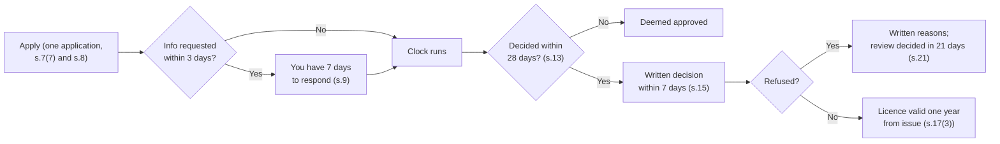

Ask a Kenyan shop owner what their business permit costs and you will usually get a number. Ask what they are entitled to in return, how long the county has to decide their application, or why they paid a full year's fee in October for a permit that expired in December, and the conversation goes quiet.

That silence is expensive. The county layer is the part of Kenyan business compliance that most SMEs treat as a ritual rather than a system: pay whatever the officer says, frame the receipt, and hope the inspection team does not come back. Meanwhile the law underneath it changed. Since 28 December 2024, every county has been bound by a national statute that sets deadlines for decisions, deems an application approved when the county misses them, fixes how long a licence lasts, and requires written reasons for a refusal.

This article does not list 47 fee schedules. Fees differ by county and change every year in each county's Finance Act, and any table we printed would be wrong somewhere by the time you read it. What it does instead is teach the structure: where the county's power to charge you comes from, what you are typically paying for, what the 2024 Act now requires of the county, and how to budget for the whole layer so that it never becomes the reason your doors are shut.

> **Key Insight:** The permit fee is rarely the real cost. For most SMEs it is a small fraction of a percent of turnover. The real costs are the ones around it: a closure for trading without a valid permit, a bank that will not open or renew a facility without a current one, and a renewal that lands in the same quarter as every other annual obligation. Under the County Licensing (Uniform Procedures) Act 2024, you also now have rights the county must respect. Most owners have never used them because they do not know they exist.

### Part 1: Where the County's Power to Charge You Comes From

Devolution gave counties two separate powers that are easy to confuse.

The first is **the power to regulate trade**. The Fourth Schedule to the Constitution assigns trade development and regulation to county governments, including trade licences, excluding the regulation of professions. That is why your trading permit comes from the county and your advocate's or accountant's practising certificate does not.

The second is **the power to raise revenue**. Article 209(3) allows a county to impose property rates and entertainment taxes, and any other tax that an Act of Parliament authorises. Article 209(4) allows counties to impose charges for the services they provide. Most of what an SME pays a county sits under one of these two headings: a licence fee for permission to trade, or a charge for a service such as a fire inspection, a health certificate or a parking bay.

Article 209(5) then sets the limit that matters most for any business that moves goods. County taxation and other revenue-raising powers must not prejudice national economic policies, economic activities across county boundaries, or the national mobility of goods, services, capital or labour. This is the clause that should, in principle, stop a lorry of produce being charged at every county line. Whether it does in practice is a different question, which Part 6 returns to.

### Part 2: What You Are Actually Paying For

The name on the receipt varies. Some counties call it a Single Business Permit, Nairobi calls its version the Unified Business Permit, and other counties use their own label. Underneath the names, the county layer for a typical SME has the same parts.

| Charge | What it pays for | Who usually pays it |
|---|---|---|
| Trade licence (Single or Unified Business Permit) | Permission to carry on a specified business activity at specified premises | Every business operating from premises in the county |
| Fire safety inspection or certificate | Inspection of premises against fire safety requirements | Premises-based businesses; often bundled into the permit in larger counties |
| Public health or food hygiene certificate | Inspection of premises and, for food handlers, medical certification of staff | Food, hospitality, salons, clinics and similar |
| Advertising and signage fees | Permission to display a sign, branding or billboard | Any business with external signage |
| Parking and loading fees | Use of county parking and loading bays | Businesses running vehicles in town centres |
| Produce and agricultural cess | A levy on agricultural produce moved or traded | Farmers, aggregators, transporters and traders |
| Market fees and stall rents | Use of a county-owned market or stall | Traders in county markets |
| Property rates | The annual tax on land and buildings | The property owner, not the tenant, unless the lease passes it on |

**The bundle question.** Several counties now combine the trade licence with fire, health and advertising charges into one permit, which is the idea behind Nairobi's Unified Business Permit. Bundling reduces the number of offices you visit. It does not reduce the number of things you are paying for, and it can hide them. Ask for the breakdown on the invoice so you know which component you are paying for and which inspection you are entitled to receive in return.

**How fees are set.** A county sets its fees in its annual Finance Act, passed by the county assembly. The trade licence fee is normally banded by the kind of business and its size, using measures such as floor area, number of employees, or the category of activity. A single-room retail shop and a supermarket in the same street pay very different amounts, and the same supermarket pays different amounts in different counties.

**Where to find your figure.** Your county's current Finance Act, published by the county assembly and in the Kenya Gazette supplement, is the primary source. The invoice generated by the county's payment portal is the practical one. Use the Finance Act to check the invoice, not the other way round.

### Part 3: The 2024 Act That Now Binds Every County

The **County Licensing (Uniform Procedures) Act, No. 8 of 2024** was assented to on 28 June 2024 and came into operation six months later, on 28 December 2024. It does not set fees. Counties keep the power to do that. What it does is impose a common procedure on how every county licenses business, and several of its provisions change what an SME can insist on.

**A County Licensing Board decides applications (section 7(2) and (3)).** Each county must establish a County Licensing Board, chaired by the county chief officer responsible for revenue, to grant, amend, renew, restore and replace licences.

**One application for several licences (sections 7(7) and 8).** A person may make one application to the same licensing authority for more than one licence for goods or services in the same sector, and every county must prescribe a single application process for applications covering more than one licence.

**Requests for more information have a clock (section 9).** If the county needs more information, it must ask within **three days** of receiving the application, and you then have **seven days** to supply it. Miss that and the county may reject the application, and you forfeit the application fee.

**Silence counts as approval (section 13).** This is the provision most owners have never heard of. A licensing authority is **deemed to have allowed an application** if it fails to determine it within **28 days** of the application being made, or within any shorter period set by the county's own licensing law. Time spent waiting for information you were asked to supply, or for a referral to another body (up to 14 days), is excluded from the count.

**Reasons in writing (section 15).** The county must tell you its decision in writing within **seven days** of making it, and if it refuses, it must give you written reasons.

**A licence lasts a year from the date it is issued (section 17(3)).** A licence is valid for the period it states, but a licence issued to a business intending to operate for a year or more is **valid for one year from the date of issue**. Section 17(4) adds that if you apply to renew before your licence expires, it stays in force until the county tells you its decision on the renewal.

**Cancellation needs notice (section 20).** Before cancelling a licence for breach of conditions, breach of the licensing law, fraud, or operating a different business from the one licensed, the county must give **14 days' notice**. Each county must also establish a review committee that includes two representatives of the county chamber of the Kenya National Chamber of Commerce and Industry.

**A review must be decided in 21 days (section 21).** A person aggrieved by a decision on an application or a cancellation may apply for a review, which must be determined within **21 days** or any shorter period in the county's own law.

**Fee changes require consultation (section 10).** Before varying the fees or conditions for a licence, a county must carry out public participation at the formative stage, a regulatory impact assessment including a cost-benefit analysis, and publish its final decision.

**Changes in your particulars (section 22).** You must notify the county of any change in your business name, directors, shareholding, address or registered particulars **within 14 days**.

**A public register, online (section 23).** Every licensing authority must keep a licence register, make it available for public inspection, and make it accessible online.

**Electronic applications by the end of 2027 (section 7(5)).** Licensing authorities have **three years from commencement**, which runs to 28 December 2027, to put in place electronic application for granting, renewing, transferring or replacing a licence.

**The penalty is real.** A person who contravenes a provision of the Act commits an offence and is liable on conviction to a fine not exceeding **KES 1,000,000**, imprisonment for up to six months, or both.

### Part 4: The Calendar-Year Problem

Many counties have historically run business permits on a calendar year. Every permit expires on 31 December, renewals are due in the first quarter, and a business that opens in October pays for a permit that lapses ten weeks later.

Section 17(3) reads against that practice. On its plain words, a licence issued to a business intending to operate for a year or more is valid for one year from the date of issue. A business licensed on 1 October 2026 should, on that reading, hold a licence valid to 30 September 2027.

We are careful about how far to push this. A county's own licensing law may still describe a calendar-year cycle, county practice has not uniformly caught up, and we have not found a reported court decision testing the point. Our working view is that the national Act sets the uniform procedure counties must follow, and that a business which paid a full annual fee mid-year has a strong argument for a full year of validity, or for a fee pro-rated to the remaining months. Raise it in writing with the county, cite section 17(3), and keep the response. That is the kind of question the section 21 review exists to answer.



### Part 5: Budgeting the County Layer

The permit is a small number with bad timing. In the counties that still run a calendar year, renewal falls in the first quarter, alongside school fees for owners with children, annual insurance renewals, and for many businesses the slow trading weeks after the festive season. That is how a modest charge becomes a cash squeeze.

Treat the whole county layer as one annual cost and fund it monthly.

$$
\text{Monthly provision} = \frac{\text{Permit} + \text{Fire} + \text{Health} + \text{Signage} + \text{Other county charges}}{12}
$$

**Worked example (illustrative figures, not any county's schedule).** A two-branch hardware business pays, per branch, an assumed KES 25,000 trade licence, KES 5,000 fire certificate and KES 8,000 signage fee. Across both branches that is KES 76,000 a year, or a monthly provision of about KES 6,333. Moved into a separate account each month, it turns a first-quarter shock into a non-event. Note that the figure is **per premises**. Each branch is licensed where it trades, which is why multi-site businesses feel the county layer more than single-site ones.

Put the line in your [13-week cash forecast](/blog/13-week-cash-forecast-kenya-sme) for the quarter in which renewal falls, so it competes for cash openly instead of ambushing you.

**Why your bank cares.** A current business permit is one of the standard documents in a bank's know-your-customer file for an SME, and lapsed licences show up when a facility is reviewed. A business that cannot produce a current permit gives a credit analyst an easy reason to pause. The [new business banking journey](/blog/new-business-banking-journey-kenya) sets out where the permit sits among the other documents.

### Part 6: Inspections, Enforcement and Cross-County Trade

**At the counter.** When an enforcement team asks for your permit, show the permit and the payment receipt. Keep both on the premises and a copy off-site. Under section 16(3), a licence must carry a unique identifier, the category code, the name of the licensing authority and the dates it comes into force and expires. A document missing those details is worth querying.

**Pay through official channels only.** Pay through the county's official portal or the account named on the official invoice, and keep the receipt. Cash paid on the street, without a system receipt, is the payment the county may later say it never received.

**Goods in transit.** For transporters and agribusinesses, the live complaint is multiple charging, where produce or goods pay cess or similar levies in more than one county on a single journey. Article 209(5) and section 24(1)(e) of the 2024 Act, which lists avoidance of multiple fees on goods transported across counties as a fee-setting principle, are the legal footing against it. The Act also tasked the Council of Governors with producing harmonisation guidelines and inter-county digital systems. In practice, keep every receipt for every county on a route, because proof of payment upstream is your only defence against paying twice downstream.

> **Risk Factors:** The highest-severity risk is closure: trading without a valid permit exposes the business to enforcement action and, under the 2024 Act, a criminal fine of up to KES 1,000,000. The most likely risk is quieter: a lapsed permit discovered during a bank review, a tender evaluation or a landlord's compliance check, which delays money you were counting on. A third risk is paying the wrong amount, either an invoice that does not match the county Finance Act or an informal payment with no system receipt. Finally, a change of directors, address or business name not notified within 14 days (section 22) can leave you holding a licence that no longer matches your business.

### Decision Framework: Getting the County Layer Under Control

```card
- icon: CheckCircle2
  title: 1. List Every County Charge You Pay
  desc: Permit, fire, health, signage, parking, cess and market fees, per premises. If you cannot list them, you cannot budget or challenge them.
  type: emerald
- icon: CheckCircle2
  title: 2. Check the Invoice Against the Finance Act
  desc: Find your county's current Finance Act and confirm the band and category on your invoice. Ask for a breakdown if charges are bundled.
  type: emerald
- icon: CheckCircle2
  title: 3. Date the Application and Count 28 Days
  desc: Keep proof of when you applied. If the county has not decided within 28 days and has not asked for information, section 13 deems the application allowed.
  type: emerald
- icon: CheckCircle2
  title: 4. Renew Before Expiry
  desc: Under section 17(4), a renewal applied for before expiry keeps the licence in force until the county decides. Renew early and keep the acknowledgement.
  type: emerald
- icon: CheckCircle2
  title: 5. Fund It Monthly
  desc: Move one twelfth of the annual county layer into a separate account each month, and show the renewal in your cash forecast.
  type: emerald
- icon: CheckCircle2
  title: 6. Use the Review Route
  desc: A refusal must come with written reasons, and a review must be decided within 21 days. Disputes about fees or validity belong there, in writing.
  type: emerald
```

### Bengula View

The county permit is the compliance obligation SMEs feel most and understand least, and for years the asymmetry ran one way: the county set the fee, the timeline and the terms, and the business paid. The 2024 Act shifts some of that balance. Deemed approval after 28 days, written reasons, a 14-day notice before cancellation and a 21-day review are not small rights, and they cost nothing to use.

Our advice is to be the business that knows them, and to use them politely and in writing. Most disputes with a county do not need a lawyer. They need a dated application, a receipt, a reference to the right section, and the patience to ask for a written answer.

We would weigh two things most heavily. First, keep the permit current as a credit asset, not just a regulatory one, because the documents that keep the county happy are the same ones that keep your bank comfortable. Second, push for the full-year validity that section 17(3) appears to give you. If enough businesses ask, practice changes faster than any circular could make it.

### Conclusion

The county layer is not going away, and the fees will keep moving with each county Finance Act. What changed in December 2024 is that the procedure is no longer whatever each county office decides on the day. Know what you pay for, check it against the law that sets it, fund it monthly, and use the timelines the Act now gives you. The permit is the cheapest line in your budget. Keep it that way.

### Frequently Asked Questions

**Does the 2024 Act mean one national business permit?** No. Each county still issues its own licence and sets its own fees. The Act standardises the procedure, not the price.

**My county has not responded to my application in five weeks. Am I licensed?** If the county did not ask you for further information and has not determined the application within 28 days, section 13 deems it allowed. Write to the county stating the date you applied and asking it to issue the licence, and keep a copy.

**I opened in October and paid a full year's fee. Does my permit really expire on 31 December?** Section 17(3) says a licence for a business intending to operate for a year or more is valid for one year from the date of issue. Raise it with the county in writing and use the review route if necessary.

**Do I need a separate permit for each branch?** Generally yes. A licence covers specified business activity at specified premises, so each location is licensed where it trades.

**Can the county close my shop without warning?** For cancellation on the grounds listed in section 20, the county must give 14 days' notice first. Trading with no licence at all is a different matter, and enforcement can be immediate.

### Related Reading

- [The New Business Banking Journey in Kenya](/blog/new-business-banking-journey-kenya) for where the permit sits in a bank's onboarding file.
- [The 13-Week Cash Forecast](/blog/13-week-cash-forecast-kenya-sme) for putting the renewal into the quarter it falls in.
- [eTIMS for Kenyan SMEs](/blog/etims-kenya-sme-guide) for the national-level compliance that sits beside the county layer.
- [Tax, Compliance, and Cash for Earners and SMEs](/blog/tax-compliance-cash-kenya-guide) for the full compliance calendar.
- [Data Protection for Kenyan SMEs](/blog/data-protection-smes-odpc-kenya) for the other compliance obligation SMEs most often skip.
- [The Complete SME Finance Handbook for Kenya](/blog/sme-finance-handbook-kenya) for the cornerstone this piece supports.

### References

- [County Licensing (Uniform Procedures) Act, No. 8 of 2024](https://new.kenyalaw.org/akn/ke/act/2024/8/eng@2024-12-28). Sections 1, 7 to 10, 13, 15 to 17, 20 to 24, and the general penalty. Read from the published text of the Act as at commencement on 28 December 2024.
- Constitution of Kenya, 2010. Article 209(3) to (5), and the Fourth Schedule, Part 2 (county functions, trade development and regulation including trade licences).
- County Governments Act, Cap 265, section 91 (public participation), as applied by section 10(2) of the 2024 Act.
- Nairobi City County Finance Act, 2023, as an example of an annual county Finance Act; fee schedules are amended annually and are not reproduced here.

*Statutory provisions are stated as at 1 November 2026 and are summarised, not reproduced in full. County fees, permit names and bundles differ by county and change with each county Finance Act; confirm the current figures with your county before paying or budgeting.*

*General market education, not individualized financial, tax, legal, or investment advice. Verify live rates, licensing, and suitability before acting.*
