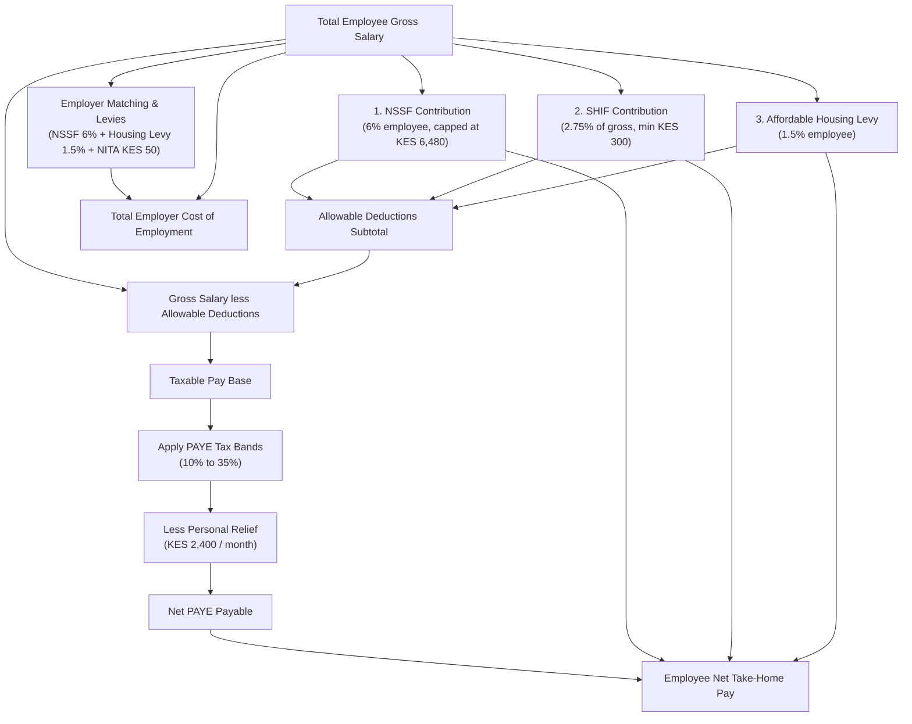
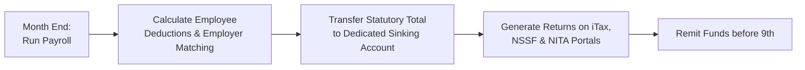

A salary quote is a deceptive number. To an employee, a KES 150,000 monthly offer letter sounds like KES 150,000 in the bank account on payday, until the first payslip arrives with five separate lines carved out. To an employer, that same KES 150,000 salary budget looks like a KES 1.8 million annual payroll expense, until statutory matching obligations, levies, and compliance risks push the true cost of employment well past KES 1.9 million.

Most discussions around Kenyan payroll collapse everything into one word: **tax**. But the statutory deduction stack is not a single tax. It is a collection of five distinct statutory regimes, administered across KRA, NSSF, SHA (SHIF) and NITA, governed by different statutes, split between employee deductions and employer obligations, and subject to an uncompromising monthly deadline.

Understanding how these five components interact is essential for both salary earners calculating their true net take-home and business owners managing working capital.

---



---

## 1. Key Insight: Both Sides of the Desk

The fundamental error made on payroll is assuming that employee deductions and employer payroll costs are the same thing. In reality, statutory payments fall into two distinct legal categories:

1. **Employee Deductions (Collected at Source):** Money earned by the worker but withheld by the employer under statutory mandate to be remitted directly to the government. These reduce the employee's gross salary to arrive at net take-home.
2. **Employer Obligations (The Tax Wedge):** Mandatory additional contributions and levies that the business must pay out of its own pocket *over and above* the agreed gross salary.

When an SME hires an employee at a agreed gross salary of KES 150,000, the employee sees **KES 103,618** land in their bank account. But the employer actually spends **KES 158,780** to maintain that position. The **KES 55,162 gap** between what the employer pays out and what the worker receives is the **total employment wedge** (34.7% of total employment cost).

If you manage a business, budgeting only for gross salaries creates an immediate cash-flow deficit every single month.

---

## 2. The Five Statutory Heads Explained

### Head 1: PAYE (Pay As You Earn)
* **Governing Body:** Kenya Revenue Authority (KRA) under the Income Tax Act (Cap 470).
* **Who Pays:** Employee (withheld at source by employer).
* **Mechanism:** Graduated progressive tax bands applied to **taxable pay**.

PAYE is the largest deduction on mid-to-high salary payslips. However, PAYE is **not** calculated directly on your gross salary. It is calculated on **Taxable Pay**, which is derived after subtracting all statutory **allowable deductions**.

#### Current Monthly PAYE Bands & Personal Relief
* **First KES 24,000:** 10%
* **Next KES 8,333** (KES 24,001 to KES 32,333): 25%
* **Next KES 467,667** (KES 32,334 to KES 500,000): 30%
* **Next KES 300,000** (KES 500,001 to KES 800,000): 32.5%
* **Above KES 800,000:** 35%
* **Personal Relief:** **KES 2,400 per month** (KES 28,800 annually), credited directly against the computed tax liability.

*Note: For detail on how PAYE interacts with freelance WHT and income tax returns, see [PAYE, withholding, and freelance tax](/blog/paye-withholding-freelance-tax-kenya).*

---

### Head 2: SHIF (Social Health Insurance Fund)
* **Governing Body:** Social Health Authority (SHA) under the Social Health Insurance Act, 2023.
* **Who Pays:** Employee (100%).
* **Rate:** **2.75% of gross salary** (minimum KES 300 per month, **no upper cap**).

SHIF replaced the legacy NHIF flat-rate rebate system. Under the old NHIF structure, contributions were capped at KES 1,700 per month regardless of income level. Under SHIF, the 2.75% rate applies across full gross earnings without a ceiling.

> **Crucial Rule (Tax Treatment):** Effective **27 December 2024** (via the Tax Laws Amendment Act 2024), SHIF contributions were changed from a tax relief into a **full allowable deduction** under Section 15(2)(ae) of the Income Tax Act. Every shilling contributed to SHIF reduces your taxable income prior to PAYE calculation.

---

### Head 3: Affordable Housing Levy (AHL)
* **Governing Body:** KRA under the Affordable Housing Act, 2024.
* **Who Pays:** Shared equally: **1.5% Employee** (withheld from gross) + **1.5% Employer** (matched contribution).
* **Rate:** 1.5% of gross salary for each side (total 3.0%). No cap.

Like SHIF, the employee's 1.5% Affordable Housing Levy contribution is an **allowable tax deduction** (Section 15(2)(ac) of the Income Tax Act). This means contributing to the Housing Levy lowers your taxable base, cushioning the net impact on your payslip.

---

### Head 4: NSSF (National Social Security Fund)
* **Governing Body:** National Social Security Fund under the NSSF Act, No. 45 of 2013.
* **Who Pays:** Shared equally: **6% Employee** + **6% Employer**.
* **Phase IV Limits (Effective February 2026):**
  * **Lower Earnings Limit (LEL):** KES 9,000 per month.
  * **Upper Earnings Limit (UEL):** KES 108,000 per month.

#### NSSF Contribution Tiers (Feb 2026 Scale)
1. **Tier I (Lower Limit):** 6% of earnings up to KES 9,000 = **KES 540 max** (matched by employer). Remitted directly to NSSF.
2. **Tier II (Upper Limit):** 6% of earnings between KES 9,001 and KES 108,000 = **KES 5,940 max** (matched by employer). Can be remitted to NSSF or contracted out to an approved Tier II Private Pension Scheme.

The maximum monthly employee NSSF deduction is **KES 6,480** (matched by KES 6,480 from the employer, totaling KES 12,960 into the pension pot). Employee NSSF contributions are fully tax-deductible up to the statutory pension ceiling of KES 30,000 per month (KES 360,000 p.a.).

*For strategic analysis on pension choices, read [NSSF Tier II vs private pension schemes](/blog/nssf-tier-ii-vs-private-pension-kenya).*

---

### Head 5: NITA (National Industrial Training Authority Levy)
* **Governing Body:** National Industrial Training Authority under the Industrial Training Act (Cap 237).
* **Who Pays:** **Employer ONLY** (100%).
* **Rate:** **KES 50 per employee per month**.

NITA is the most frequently missed statutory line by new business owners. It is **never** deducted from an employee's payslip. It is an employer-paid levy charged on all registered employers in Kenya to fund industrial training programs.

While KES 50 per worker seems nominal, failure to register and remit NITA leads to compounding penalties and blocks the issuance of a KRA Tax Compliance Certificate (TCC).

---

## 3. The Full Worked Payslip & Employment Wedge

To illustrate how these five heads operate together, consider a full-time employee in Nairobi with a gross monthly salary of **KES 150,000**.

### Step 1: Calculate Employee Statutory Allowable Deductions

```math
\text{NSSF (Max Tier I + Tier II)} = \text{KES } 6,480.00
```
```math
\text{SHIF (2.75\% of KES 150,000)} = \text{KES } 4,125.00
```
```math
\text{Housing Levy (1.5\% of KES 150,000)} = \text{KES } 2,250.00
```
```math
\text{Total Allowable Deductions} = 6,480 + 4,125 + 2,250 = \text{KES } 12,855.00
```

### Step 2: Compute Taxable Base & PAYE

```math
\text{Taxable Pay} = 150,000 - 12,855 = \text{KES } 137,145.00
```

Now apply the progressive PAYE tax brackets to KES 137,145:
* **Band 1 (First 24,000 @ 10%):** KES 2,400.00
* **Band 2 (Next 8,333 @ 25%):** KES 2,083.25
* **Band 3 (Remaining 104,812 @ 30%):** KES 31,443.60
* **Gross PAYE Tax:** 2,400 + 2,083.25 + 31,443.60 = **KES 35,926.85**
* **Less Personal Relief:** (KES 2,400.00)
* **Net PAYE Payable:** **KES 33,526.85**

### Step 3: Breakdown Table: Employee View vs. Employer Cost

| Item / Head | Employee Payslip (Deduction) | Employer Contribution (Cost) | Total Remitted to State |
|---|---|---|---|
| **Gross Salary** | **KES 150,000.00** | n/a | n/a |
| **NSSF (Tier I + II)** | (KES 6,480.00) | KES 6,480.00 | KES 12,960.00 |
| **SHIF (2.75%)** | (KES 4,125.00) | KES 0.00 | KES 4,125.00 |
| **Housing Levy (1.5%)** | (KES 2,250.00) | KES 2,250.00 | KES 4,500.00 |
| **PAYE Tax** | (KES 33,526.85) | KES 0.00 | KES 33,526.85 |
| **NITA Levy** | KES 0.00 | KES 50.00 | KES 50.00 |
| **TOTALS** | **Net Take-Home: KES 103,618.15** | **Extra Cost: KES 8,780.00** | **Total State Bite: KES 55,161.85** |

### Summary of the Wedge
* **Employee Take-Home:** KES 103,618.15 (69.1% of gross)
* **Total Deductions from Employee:** KES 46,381.85 (30.9% of gross)
* **Total Employer Cash Outlay:** **KES 158,780.00** (Gross salary + KES 8,780 employer obligations)
* **Total Employment Wedge:** KES 55,161.85 (The state receives **34.7%** of the total funds spent by the employer).

---

## 4. Compliance Rhythm & Sinking-Account Discipline

For Kenyan SMEs, statutory deductions represent an acute operational hazard. Every month, employers act as tax collection agents for the government.

### The 9th-of-the-Month Deadline
All five statutory payments (PAYE, SHIF, Housing Levy, NSSF and NITA) must be remitted on or before the **9th day of the following month**.

Unified Payroll processing via KRA iTax allows combined payment generation for PAYE, Housing Levy, and SHIF, while NSSF and NITA portals require explicit monthly return uploads.



### Statutory Penalties for Late Remittance

Failing to remit statutory payments on time triggers heavy non-negotiable statutory penalties:

| Statutory Head | Late Filing / Remittance Penalty | Interest / Additional Charges |
|---|---|---|
| **PAYE** | **25%** of tax due | **1% per month** simple interest |
| **Housing Levy** | **3% per month** of unpaid amount | Compounding monthly |
| **SHIF** | **2% per month** of unpaid amount | Applied on outstanding balance |
| **NSSF** | **5% per month** of unpaid amount | Minimum KES 1,000 fine |
| **NITA** | **5% per month** penalty | Blocked Tax Compliance Certificate |

> **Warning for Directors:** Under Section 97 of the Tax Procedures Act, statutory deductions withheld from employees are held in trust for the government. If an employer defaults on PAYE, NSSF, or SHIF, directors can be held **personally liable** for the unremitted funds.

### The Sinking-Account Solution
To prevent the 9th-of-the-month liquidity shock:
1. Open a separate high-yield business savings or money market account designated as your **Payroll Tax Sinking Account**.
2. On payday (e.g., the 28th), when paying net salaries to staff, immediately transfer the **entire statutory burden** (KES 55,161 in our example above) out of your main operating account into the sinking account.
3. On the 5th of the next month, execute payments directly from the sinking account to KRA, NSSF, and NITA.

*For more on structured SME cash-flow management, read [Tax, compliance, and cash for earners and SMEs](/blog/tax-compliance-cash-kenya-guide) and [13-Week cash forecast for SMEs](/blog/13-week-cash-forecast-kenya-sme).*

---

## 5. Risk Factors

```card
- icon: AlertTriangle
  title: Treating Withheld Tax as Working Capital
  desc: The single fastest way to destroy an SME. Using employee PAYE or SHIF deductions to pay suppliers or rent creates a compounding debt trap with 25% initial penalties.
  type: amber
- icon: ShieldAlert
  title: Personal Director Liability
  desc: Statutory funds withheld from salaries are legally held in trust. KRA and NSSF enforcement officers can freeze personal bank accounts of company directors for unremitted payroll taxes.
  type: amber
- icon: FileX
  title: Tax Compliance Certificate (TCC) Blockade
  desc: A single month of unremitted NITA or PAYE blocks your TCC. Without a valid TCC, your business cannot bid for corporate or public tenders (AGPO), nor access bank credit lines.
  type: amber
```

---

## 6. Decision Framework: 5-Step SME Payroll Checklist

```card
- icon: CheckCircle2
  title: 1. Audit Salary Contracts
  desc: Ensure all employment letters clearly state whether figures are Gross Salary or Net Salary, and explicitly define statutory matching rules.
  type: emerald
- icon: CheckCircle2
  title: 2. Automate Allowable Deductions
  desc: Verify that your payroll software correctly applies SHIF, Housing Levy, and NSSF as pre-tax allowable deductions before computing PAYE.
  type: emerald
- icon: CheckCircle2
  title: 3. Factor the 6% + 1.5% + KES 50 Overhead
  desc: When hiring new staff, calculate total employment cost as Gross + 7.5% + KES 50. Never budget on gross salary alone.
  type: emerald
- icon: CheckCircle2
  title: 4. Maintain a Statutory Sinking Account
  desc: Move statutory funds into a dedicated account on payday. Never let unremitted statutory money sit in your main operating account.
  type: emerald
```

---

## 7. Bengula View

Statutory payroll compliance is rarely viewed as a growth driver, but in Kenyan business, it is a primary commercial asset. 

Lenders assessing an SME for credit look past audited accounts straight at statutory remittance records. A business that consistently clears its PAYE, NSSF, SHIF, and NITA on the 5th of every month demonstrates operational control, financial solvency, and low governance risk. When submitting a credit pack (as outlined in [the anatomy of a perfect bank proposal](/blog/anatomy-of-a-bank-proposal-kenya)), a clean statutory record is what turns a high-risk application into an approved credit line.

For employees, understanding the allowable deduction rules is the key to managing your personal tax burden. For employers, mastering the five statutory heads is what separates scalable enterprises from fragile operations.

---

### Related Reading
* [PAYE, Withholding, and Freelance Tax in Kenya](/blog/paye-withholding-freelance-tax-kenya)
* [Tax, Compliance, and Cash for Earners and SMEs](/blog/tax-compliance-cash-kenya-guide)
* [NSSF Tier II vs Private Pension Schemes in Kenya](/blog/nssf-tier-ii-vs-private-pension-kenya)
* [Check-Off and Salary Loans in Kenya](/blog/check-off-salary-loans-kenya)
* [13-Week Cash Forecast for SMEs](/blog/13-week-cash-forecast-kenya-sme)
