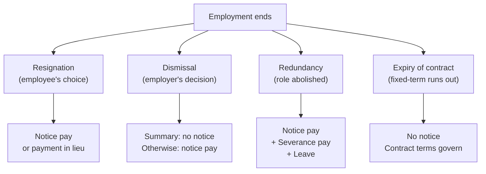

A Kenyan salary earner can spend years learning how money arrives each month and never once look at the rules for when it stops arriving. The gap is not trivial. A redundancy handled correctly produces notice pay, severance pay, leave days, pension access, and a specific tax treatment. The same redundancy handled badly produces nothing except a claim to make in a forum where the employer already holds the evidence.

This guide is about the money that sits around the exit. It is not a labour law manual and it does not cover unfair dismissal claims, collective bargaining, or industrial disputes. It covers what the Employment Act 2007 says about how employment ends, what each ending entitles the parties to, and what happens to the money that was building inside the relationship while it lasted.

> **Key Insight:** There is no statutory right to severance pay in Kenya outside redundancy. Gratuity is not required by statute at all. Both are commonly assumed to be automatic entitlements, and both are, in most employment relationships, entirely contractual. If the contract does not provide for them, they do not exist. This single distinction explains most of the surprise at exit.

### Part 1: The Four Ways a Job Ends

The Employment Act 2007 recognises four broad causes of termination that produce different financial consequences. Getting the cause wrong does not just lose an argument. It loses money.



Each path produces a different terminal dues calculation, and the distinction between dismissal and redundancy is the one that matters most financially, because only redundancy triggers statutory severance.

### Part 2: Notice Periods

Section 35 of the Employment Act sets **minimum** notice periods. A contract may provide for longer, and where it does, the contract governs. It may not provide for shorter.

| Employment term | Minimum notice (s.35(1)) |
|---|---|
| Daily or hourly contract | End of the day |
| Weekly or fortnightly contract | End of the week |
| Monthly contract (by far the commonest) | **28 days** |
| Period exceeding one month | **28 days** |

Notice must be in writing (s.35(2)). Oral notice is not valid notice under the Act. A resignation scribbled on a WhatsApp message and acknowledged in writing by the employer may or may not survive a dispute, and that is a problem for a lawyer, not for this guide. Put it on paper.

**Payment in lieu of notice** (s.36(1)(a)) allows either party to terminate the contract immediately by paying the wages the employee would have earned during the notice period. This is not a penalty. It is a contractual right. An employer who wants you gone today owes you a month's gross pay (or whatever the contractual notice period is) on top of your final salary.

The calculation is straightforward:

$$ \text{Notice pay} = \text{Gross monthly salary} \times \frac{\text{Contractual notice period (days)}}{30} $$

Where the contract says three months' notice, notice pay is three months' gross. Where it says 28 days, notice pay is roughly one month's gross.

### Part 3: Redundancy and the Right to Severance

Section 40 of the Employment Act defines redundancy as the loss of employment through no fault of the employee, including where an employer restructures, downsizes, or abolishes a role. It imposes a procedure that is commonly ignored:

1. The employer must **notify the employee, any recognised trade union, and the labour officer in writing** at least one month before the intended date of termination (s.40(1)(a) and (b)).
2. The employer must consult with the employee and the union **before making a final decision** on severance terms (s.40(1)(c)).
3. The employer must consider **seniority in time** and the need to balance all relevant factors, including skill, ability and reliability (s.40(1)(d)).
4. The employer must give the employee or trade union a statement in writing of the reasons for and the extent of the intended redundancy (s.40(1)(e)).

A redundancy that skips the consultation and notification process is not a valid redundancy under the Act, which means the employee may challenge it before the Employment and Labour Relations Court.

**Severance pay is triggered only by redundancy.** Section 40(1)(g) provides that severance pay shall not be less than **fifteen days' pay for each completed year of service**, unless a more favourable provision exists in the contract or a collective bargaining agreement.

$$ \text{Minimum severance} = \frac{\text{Monthly basic pay}}{2} \times \text{Completed years of service} $$

On a basic salary of KES 120,000 with ten completed years:

| Component | Calculation | Amount (KES) |
|---|---|---|
| Minimum severance (15 days × 10 years) | 60,000 × 10 | **600,000** |
| Notice pay (28 days in lieu) | ~120,000 | **120,000** |
| Accrued leave (21 days, untaken) | 120,000 ÷ 30 × 21 | **84,000** |
| **Total minimum terminal dues** | | **804,000** |

Those figures are the statutory floor, not the ceiling. Many employment contracts, particularly in multinationals and senior roles, provide for one month per year or more. The contract governs upward; the statute governs downward.

### Part 4: Dismissal, and Why It Produces Less

Dismissal is the employer's unilateral termination. Where it follows due process, notice (or payment in lieu) and accrued leave are owed. Where it is **summary dismissal** under section 44 of the Act, for gross misconduct, the employer may terminate without notice.

The grounds for summary dismissal are listed in section 44(4) and include wilful breach of duty, misconduct, absence without leave, and conviction of a criminal offence. The employer must still demonstrate that the grounds were valid and that the employee was heard.

**The critical financial difference:** a lawful dismissal does not trigger severance pay. Severance is a redundancy entitlement. An employee dismissed for performance, restructured out in substance but called dismissed, or terminated during probation receives notice pay and leave but not severance, unless the contract says otherwise.

This is why the characterisation of the exit matters enormously. An employer who says "your role has been abolished" owes severance. An employer who says "your performance is unsatisfactory" and follows a fair process does not. The facts are the same in many cases. The label determines the money.

### Part 5: Gratuity Is Not a Statutory Right

This is the single most misunderstood element of Kenyan terminal dues. The Employment Act does not provide for gratuity. There is no section that requires an employer to pay a sum of money proportional to years of service as a parting benefit upon any form of termination.

Gratuity exists where it is **contractually agreed**. Many employers, particularly in government, parastatals, and long-established private firms, include a gratuity clause in their terms of service or in a collective bargaining agreement. The clause typically specifies a formula, for example, one month's basic salary per completed year of service, and it defines the qualifying conditions, which almost always include completing a minimum service period and leaving in good standing.

If the contract says nothing about gratuity, there is no gratuity. If the contract says gratuity is payable on retirement but is silent on resignation, then resignation does not trigger it. Read the clause, including the conditions, before you count on the money.

### Part 6: Annual Leave on Exit

Section 28 of the Employment Act entitles an employee to not less than **21 working days of annual leave** with full pay, after every twelve consecutive months of service with the same employer.

On termination, **accrued but untaken leave must be paid out** (s.28(5)). The calculation converts leave days into daily pay:

$$ \text{Leave pay} = \frac{\text{Monthly basic pay}}{30} \times \text{Accrued untaken days} $$

Two traps recur. Employers who operate a "use it or lose it" leave policy cannot lawfully forfeit leave that has been accrued under the statute. And employees who carried forward leave from multiple years should have records to prove the balance, because the employer's system may show zero if the policy assumed expiry.

### Part 7: Pension and Provident Fund Access

Where the employer operates or contributes to a registered pension scheme or provident fund, the employee's access to those funds on exit is governed by the **Retirement Benefits Act 1997** and the scheme's trust deed and rules, not by the Employment Act.

The short version: contributions are locked until a qualifying event occurs (resignation, retirement, redundancy, disability, or death). On resignation before retirement age, the member may transfer benefits to a new employer's scheme, to an individual retirement benefits scheme, or receive a deferred pension. Cash withdrawal of the full amount before retirement is possible only in specific circumstances and carries tax consequences.

Since **1 July 2025**, the Finance Act 2025 replaced the old KES 600,000 lump-sum exemption and KES 300,000 annual exemption with **conditions-based access**: retirement age (or within five years of it), ill health, or twenty or more years of membership. Several KRA and RBA pages still display the old figures. The statutory position is the one that governs.

The pension mechanics and the annuity-versus-drawdown decision on retirement are treated in full in [retirement, pensions, and leaving money behind](/blog/retirement-income-annuity-drawdown-kenya). This article stays with the exit money that the employer owes directly.

### Part 8: Tax on Terminal Dues

Terminal dues are taxable, but the treatment differs by component.

| Component | Tax treatment |
|---|---|
| Notice pay (payment in lieu) | Taxed as employment income through PAYE in the month of payment |
| Accrued leave pay | Taxed as employment income through PAYE |
| Severance pay | Taxed under graduated bands in the year of receipt; often qualifies for a **lower effective rate** through averaging under the ITA |
| Gratuity (contractual) | Taxed as employment income; where the employment was five years or more, the ITA allows the tax to be computed over the period of employment rather than in a single year, reducing the effective rate |
| Pension withdrawal | Subject to the retirement benefits tax regime; lump sum withdrawals may attract tax at graduated rates |

The practical consequence is that a terminal payment loaded into a single payroll month will push the earner into higher PAYE bands and produce a tax bill that looks worse than it is. An employer who processes the payment correctly will apply the annual-averaging method where the law allows it, and the employee should confirm this before accepting the final payslip.

For the mechanics of how PAYE bands, personal relief, and allowable deductions interact, see [PAYE, withholding, and freelance tax](/blog/paye-withholding-freelance-tax-kenya).

### Part 9: The Probation Problem

Section 42 of the Employment Act allows for a probationary period of not more than **six months**, extendable to twelve months where the nature of the work warrants it and the contract so provides. The notice period during probation is **seven days** unless the contract provides for a longer period.

The financial implication is that an employee terminated during probation is entitled to seven days' notice pay (or payment in lieu) and accrued leave, but not severance, and usually not gratuity unless the contract provides otherwise. Pension contributions vest according to the scheme's rules, and many schemes impose a minimum membership period before employer contributions vest, so a three-month probationer may leave with only their own contributions.

### Risk Factors

- **The Employment Act sets floors, not ceilings.** Every entitlement in this article is a statutory minimum. The contract, a CBA, or company policy may provide for more, and frequently does. The contract governs upward.
- **An exit letter is not a waiver.** Signing a "full and final settlement" letter does not necessarily bar a later claim if the settlement was below the statutory minimum or was agreed under duress. That is a legal question, not a payroll one, and it requires an advocate.
- **Constructive dismissal** (where the employer makes conditions intolerable so the employee resigns) is treated as a dismissal by the employer for the purposes of the Act, which may trigger notice and, if the substance was redundancy, severance. But proving it requires evidence, not resentment.
- **Statutory dates move.** The pension access conditions changed on 1 July 2025 and KRA guidance has not fully caught up. Verify pension withdrawal tax treatment directly with KRA or your scheme administrator before making any withdrawal election.

### Decision Framework

```cards
- icon: UserMinus
  title: You Are Resigning
  desc: "Give written notice per your contract (minimum 28 days). You are owed accrued leave, any pro-rata salary, and your pension is accessible per the scheme rules. No severance. Gratuity only if the contract provides for it on resignation."
  type: violet
- icon: AlertTriangle
  title: You Are Being Made Redundant
  desc: "Confirm the employer followed the s.40 procedure: written notice to you, the union, and the labour officer; consultation before final terms. You are owed notice pay, accrued leave, and a minimum 15 days' pay per completed year as severance. Check for a better contractual provision."
  type: amber
- icon: XCircle
  title: You Are Being Dismissed
  desc: "Distinguish summary dismissal (gross misconduct, no notice) from ordinary dismissal (notice or pay in lieu). No severance unless the dismissal was in substance a redundancy. Accrued leave is still owed. If you believe the dismissal was unfair, the remedy is the Employment and Labour Relations Court, not the payroll."
  type: amber
- icon: Clock
  title: Your Fixed-Term Contract Is Ending
  desc: "No notice is required where the contract expires by its own terms. Terminal entitlements are whatever the contract provides. If the employer renews you repeatedly and then stops, the question of whether you have become a permanent employee with notice and redundancy rights is a live one."
  type: emerald
```

### Bengula View

Terminal dues are a cash-flow event that most people encounter once or twice in a career and prepare for never. The surprise is not that the amounts can be large, it is that the amounts depend almost entirely on the legal character of the exit and the wording of the contract, and most employees have read neither.

The same discipline we apply across the library, know the order of operations, run the numbers before the event, check what the statute says rather than what the office says, applies here with particular force because the stakes are concentrated. A person who negotiates a salary difference of KES 10,000 a month has a decade to recover the gap. A person who accepts a terminal settlement KES 600,000 below what the law provides has one conversation, and it is usually already over by the time they learn the figure.

Read your contract. Count your leave days. Know whether your employer calls the exit a dismissal or a redundancy, and know why that word matters. The money follows the label.

### Related Reading

- [The Statutory Deduction Stack in Kenya](/blog/statutory-deductions-payroll-kenya) for the five heads that were building on the payslip throughout employment.
- [PAYE, Withholding, and Freelance Tax](/blog/paye-withholding-freelance-tax-kenya) for how the terminal payment is taxed.
- [Tax, Compliance, and Cash](/blog/tax-compliance-cash-kenya-guide) for the filing calendar and the employment wedge.
- [Retirement, Pensions, and Leaving Money Behind](/blog/retirement-income-annuity-drawdown-kenya) for pension access on exit and the annuity-versus-drawdown decision.
- [NSSF Tier II vs Private Pension](/blog/nssf-tier-ii-vs-private-pension-kenya) for what the contributions were buying.
- [Check-Off and Salary Loans](/blog/check-off-salary-loans-kenya) for what happens to a loan deducted from a salary that has stopped.
- [The Complete Guide to Personal Finance in Kenya](/blog/ultimate-guide-to-personal-finance-kenya) for where terminal money sits in the wider household plan.
- [Debt Consolidation and Refinancing](/blog/debt-consolidation-refinancing-kenya) for restructuring obligations if exit pay is the only liquidity event available.

### References

- Employment Act, 2007 (No. 11 of 2007). Sections 28 (annual leave), 35 and 36 (notice), 40 (redundancy and severance), 42 (probation), 44 (summary dismissal). Revised Edition 2012.
- Retirement Benefits Act, 1997 (No. 3 of 1997), and Retirement Benefits (Occupational Retirement Benefits Schemes) Regulations, 2000.
- Finance Act 2025: replacement of lump-sum and annual pension exemption thresholds with conditions-based access, effective 1 July 2025.
- Income Tax Act, Cap 470. Sections on employment income, taxation of terminal benefits, and averaging provisions for long-service employees.
- Kenya Revenue Authority, [Income Tax](https://www.kra.go.ke/individual/filing-paying/types-of-taxes/income-tax), accessed September 2026.

---

*Employment law provisions are stated as at September 2026 and are summarised, not reproduced in full. Statutes are amended; verify the current text on Kenya Law before acting.*

*This article is general financial and employment education, not legal advice, and it does not create an advocate-client or employer-employee advisory relationship. If you have been terminated, are facing redundancy, or are negotiating terminal dues, instruct a qualified advocate or consult a registered labour consultant rather than relying on any general guide, including this one.*
